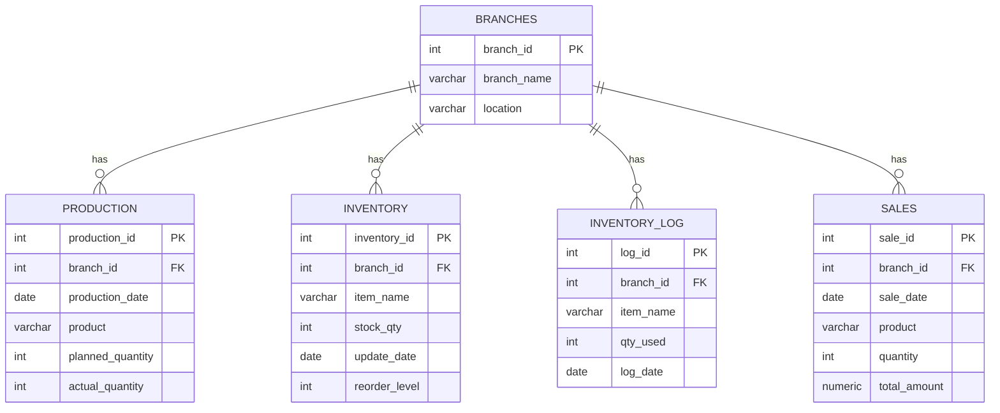

# Marinduqueño's Litson Manok – Branch Management Dashboard

A Laravel 12 + PostgreSQL web application for monitoring production, inventory and sales across three Litson Manok branches: Calauan Plaza, Dayap Palengke and San Pablo City.

## Features

- Dashboard for selecting a branch
- Per-branch production input, records and trend chart
- Inventory management: add items, add stock, use stock (stock can never go negative)
- Summary dashboard: KPIs, 7-day forecast, anomaly detection, restock recommendations and branch comparison
- Input validation with clear error and success messages

## Tech stack

| Layer | Technology |
|---|---|
| Framework | Laravel 12 (PHP 8.2) |
| Database | PostgreSQL 18 (`capstone_db`) |
| Frontend | Blade, Bootstrap 5, Chart.js (served locally from `public/vendor`) |

## Requirements

- PHP 8.2 or newer with the `pdo_pgsql` and `pgsql` extensions enabled
- Composer
- PostgreSQL

## Setup

1. Install dependencies:
   ```
   composer install
   ```
2. Create the environment file and app key:
   ```
   copy .env.example .env
   php artisan key:generate
   ```
3. Create an empty database named `capstone_db` in PostgreSQL (for example in pgAdmin).
4. Open `.env` and set the database credentials:
   ```
   DB_CONNECTION=pgsql
   DB_HOST=127.0.0.1
   DB_PORT=5432
   DB_DATABASE=capstone_db
   DB_USERNAME=postgres
   DB_PASSWORD=your_password
   ```
5. Build the tables and add the three branches:
   ```
   php artisan migrate
   php artisan db:seed
   ```
6. Start the server and open http://127.0.0.1:8000:
   ```
   php artisan serve
   ```

## Pages and routes

| Route | Method | Purpose |
|---|---|---|
| `/` | GET | Dashboard with branch cards |
| `/home` | GET | Production totals per branch |
| `/branch/{id}` | GET | Production and inventory for one branch |
| `/summary` | GET | Business-intelligence summary (`?branch=<id>` filters one branch) |
| `/add-production` | POST | Save today's production |
| `/add-inventory` | POST | Add stock to an item (creates it if new) |
| `/use-inventory` | POST | Use stock; refuses unknown items or quantities above what is available |

## Database design



**Constraints and indexes** (created by the migration `setup_capstone_schema`):

- Every table has a primary key; `production`, `inventory`, `inventory_log` and `sales` reference `branches` through a foreign key.
- `inventory` has a unique rule on `(branch_id, item_name)`.
- `CHECK` constraints keep stock, quantities and amounts from going negative.
- Key columns are `NOT NULL`.
- Indexes on `(branch_id, date)` for `production`, `sales` and `inventory_log`.

## Project structure (MVC)

| Part | Location |
|---|---|
| Routes | `routes/web.php` |
| Controllers | `app/Http/Controllers/BranchController.php`, `SummaryController.php` |
| Service (summary calculations) | `app/Services/SummaryService.php` |
| Models (Eloquent) | `app/Models/` – `Branch`, `Production`, `Inventory`, `InventoryLog`, `Sale` |
| Views | `resources/views/` – `index`, `home`, `branch`, `summary` |
| Migration | `database/migrations/*_setup_capstone_schema.php` |
| Seeder | `database/seeders/DatabaseSeeder.php` |

Controllers only handle the request and response; calculations live in `SummaryService`; database access goes through the models.

## Validation and edge cases

- Quantities must be whole numbers within allowed ranges; empty or negative input is rejected with an error message.
- Using stock locks the row (`lockForUpdate`) inside a transaction, so stock never goes negative even with simultaneous requests.
- Using an item that does not exist in the branch, or more than is in stock, shows a clear message and changes nothing.
- Every stock usage is written to `inventory_log`, which feeds the days-of-cover calculation.

## Group members

- Alvarez, Timothy
- Cervantes, Chrissa Mae
- Larona, Trish Anne